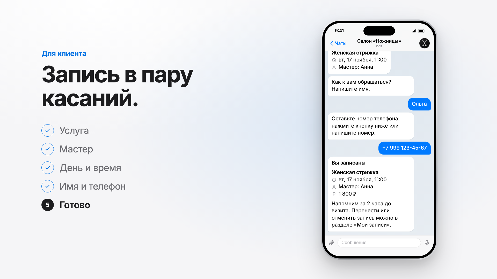
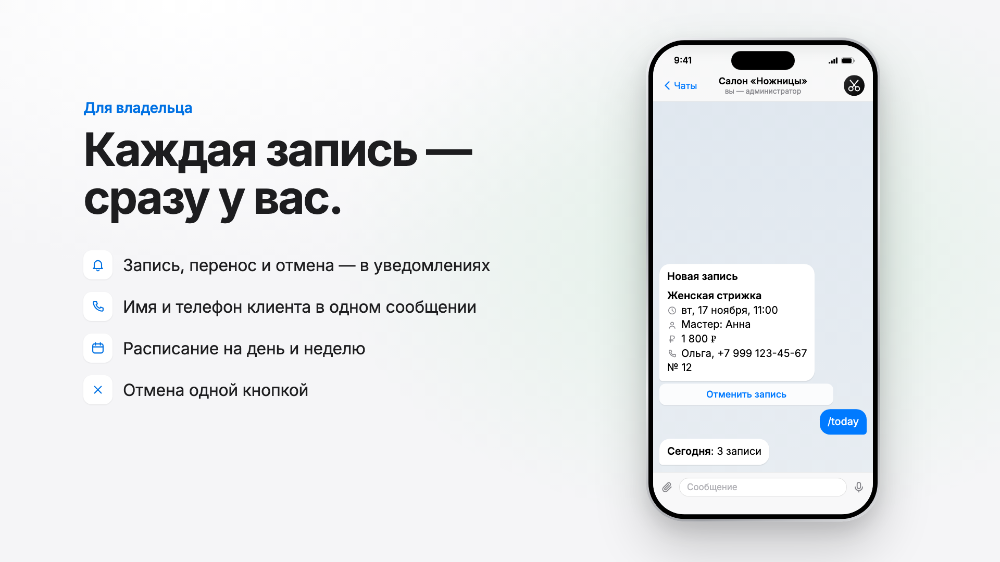
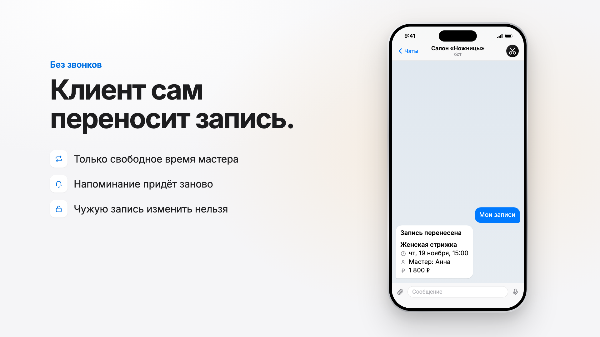
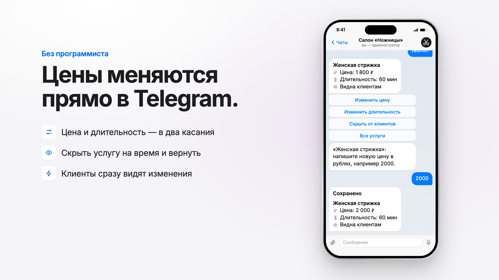

# Telegram-бот онлайн-записи на услуги

Бот для салонов красоты, барбершопов, массажа, репетиторов и любых услуг по записи.
Клиент сам выбирает услугу, мастера и свободное время, администратор получает уведомление.

**Живое демо:** [@nozhnitsy_demo_booking_bot](https://t.me/nozhnitsy_demo_booking_bot) — кнопка «👀 Как это видит администратор» показывает сторону владельца.
**Видео (48 с):** [portfolio/booking-bot-promo-web.mp4](portfolio/booking-bot-promo-web.mp4)



| Уведомление администратору | Перенос записи | Цены прямо в Telegram |
|---|---|---|
|  |  |  |

## Возможности

**Для клиента**
- 📅 Запись в несколько нажатий: услуга → мастер (или «любой свободный») → дата → время → имя и телефон → подтверждение
- Показываются только реально свободные слоты с учётом длительности услуги и личного графика мастера
- 📞 Телефон одной кнопкой («Отправить мой номер») или вручную, с проверкой формата
- 📋 «Мои записи»: перенос на другое время и отмена в пару нажатий
- 💰 Прайс-лист с графиком мастеров
- ❓ Частые вопросы: адрес, график, оплата, подготовка к процедурам
- ⏰ Автоматическое напоминание за 2 часа до визита (после переноса — заново)

**Для администратора**
- 🆕 Мгновенное уведомление о каждой записи, переносе и отмене: услуга, мастер, время, имя, телефон, ссылка на профиль
- ❌ Отмена записи кнопкой под уведомлением — клиент получает сообщение
- 📅 Панель `/admin`: расписание на сегодня, завтра и неделю
- 💰 Услуги и цены прямо из Telegram: изменить цену, длительность, скрыть или вернуть услугу — без программиста и без перезапуска

**Календарь прямо в чате** (`WIDGETS=1`, Telegram Bot API 10.4)
- Кнопка «🗓 Открыть календарь на неделю» присылает интерактивный HTML-виджет: дни и свободное время мастера, выбор одним касанием, без мини-приложения и без перехода на сайт
- Выбранное время проверяется на сервере; если его успели занять, календарь в сообщении обновляется сам
- Кнопочная запись остаётся: она работает в любом Telegram, виджет — дополнительный способ

**Демо-режим** (`DEMO_MODE=1`)
- Кнопка «👀 Как это видит администратор» показывает любому пользователю сторону владельца салона
- В демо видны и отменяются только собственные записи, уведомления администратора приходят самому пользователю, изменения цен не сохраняются

**Надёжность**
- Двойная запись невозможна: проверка и сохранение выполняются в одной транзакции базы данных, даже если два клиента нажмут «Подтвердить» одновременно. Занятость считается отдельно по каждому мастеру
- Время повторно проверяется на сервере на каждом шаге: устаревшие или подделанные кнопки не сработают
- Клиент может перенести или отменить только свою запись
- Всё, что вводит пользователь, экранируется перед выводом
- Изменения каталога записываются в файл атомарно: файл не повредится при сбое
- Старая база без мастеров обновляется автоматически при запуске
- Токен бота хранится в `.env`, не в коде

## Настройка

Услуги, мастера, график и частые вопросы задаются в `services.json`:

```json
{
  "business_name": "Салон «Ножницы»",
  "description": "Текст, который клиент видит до нажатия Start",
  "work_hours": {"start": "10:00", "end": "20:00", "slot_step_min": 30,
                 "days_ahead": 7, "weekdays": [0, 1, 2, 3, 4, 5]},
  "services": [
    {"id": "haircut", "name": "Женская стрижка", "duration_min": 60, "price": 1800}
  ],
  "masters": [
    {"id": "anna", "name": "Анна", "services": ["haircut"],
     "start": "10:00", "end": "19:00", "weekdays": [0, 1, 2, 3, 4]}
  ],
  "faq": [
    {"q": "📍 Где вы находитесь?", "a": "ул. Примерная, 1"}
  ]
}
```

- `weekdays`: 0 — понедельник … 6 — воскресенье.
- У мастера можно не указывать часы и дни — тогда берётся общий график. Если раздела `masters` нет, работает один мастер.
- Цены, длительность и видимость услуг администратор меняет из Telegram; остальное — в файле с перезапуском бота.

## Запуск

Нужен Python 3.12+ и [uv](https://docs.astral.sh/uv/).

```bash
cp .env.example .env      # впишите BOT_TOKEN от @BotFather и свой ADMIN_IDS
uv sync
uv run booking-bot
```

Тесты (расчёт слотов, база, каталог и сквозной сценарий через обработчики без Telegram):

```bash
uv run pytest
```

## Стек

Python 3.12 · aiogram 3 · SQLite · asyncio · pytest

## Структура

```
src/booking_bot/
  config.py      — настройки из .env, каталог услуг/мастеров/FAQ с сохранением изменений
  schedule.py    — расчёт рабочих дней и слотов (чистые функции)
  slots.py       — свободное время с учётом мастеров
  db.py          — записи в SQLite: защита от двойной записи, перенос, миграции
  handlers/
    client.py    — запись, мои записи, перенос, частые вопросы
    admin.py     — панель администратора, расписание, услуги и цены, демо-режим
  widget.py      — календарь-виджет: HTML-шаблон, данные, обработка нажатий (widget_query)
  reminders.py   — фоновые напоминания
  keyboards.py, texts.py, notify.py
tests/
  test_core.py   — слоты, база, каталог
  test_flow.py   — полный сценарий клиента и администратора
  test_widget.py — календарь-виджет: лимиты Telegram, данные, запись через виджет
```

## Что можно добавить под заказ

Предоплата (ЮKassa) · выгрузка в Google Таблицы · синхронизация с Google Календарём ·
рассылки · отзывы после визита · несколько филиалов.
